<div align="center">

# XJTU-energy-learning-platform

### 能研智助 · 储能科研学习智慧平台

从读懂一篇论文，到积累知识、处理数据、形成可验证的科研想法。

[](LICENSE)


[📦 下载 Windows 便携版](https://github.com/Viyao691/XJTU-energy-learning-platform/releases/tag/v0.1.0-windows-portable) · [🎬 在线播放完整演示](https://viyao691.github.io/XJTU-energy-learning-platform/) · [功能介绍](#功能介绍) · [快速开始](#快速开始)

</div>

公网轻量版：[energy.viyao.cn](https://energy.viyao.cn)。新用户在独立登录页选择“注册账号”，通过邮箱验证码注册并登录；已有账号选择“邮箱登录”。登录页支持浅色、深色和手机布局。“游客登录”弹窗可进入公开知识浏览，个人论文与科研功能需账号登录。工作台左下角账号卡显示当前身份和账号操作。

手机Web使用紧凑标题、较小插画和单列表单；论文原文以逐页图像阅读，可翻页或打开原始PDF；流程图默认适应屏宽，放大后在图表内滚动。手机导航也显示账号卡。手机适配与验证范围见[逐页审查记录](docs/mobile/2026-10-15-mobile-audit.md)，本次无声竖屏截图巡览保存在本地output/mobile/2026-10-15/。


## 🎬 平台演示

**约 5 分 15 秒，看一遍从论文发现、研读到学习与科研实践的完整操作。**

点击下方预览进入播放器，直接观看完整视频，支持进度跳转、音量调节和全屏。

[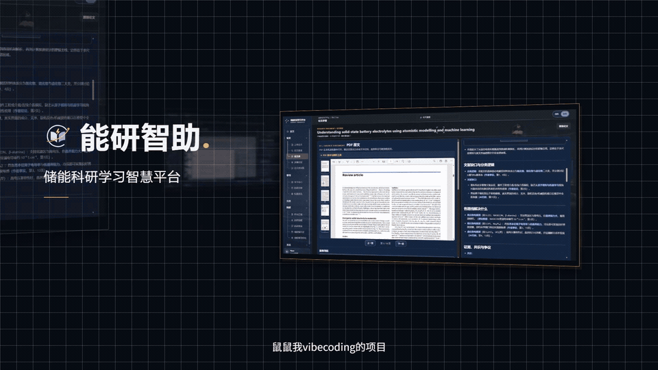](https://viyao691.github.io/XJTU-energy-learning-platform/)

[**▶ 在线播放完整演示**](https://viyao691.github.io/XJTU-energy-learning-platform/) · [下载原版 1080p MP4](https://github.com/Viyao691/XJTU-energy-learning-platform/releases/download/platform-demo-2026-10-11/energy-platform-demo-1080p.mp4) · [视频发布页](https://github.com/Viyao691/XJTU-energy-learning-platform/releases/tag/platform-demo-2026-10-11)

## 解决的问题

储能专业的学习与科研，需要把 **知识积累、行业认知、机会发现与科研实践** 连接起来。

平台围绕以下五类需求，组织可以持续使用的学习与研究工具。

### ① 专业学习：知识零散，复习缺少抓手

专业概念、材料机理与前沿研究分散在不同资料中，读过之后也容易遗忘。

- **梳理知识**：结合术语解释与知识卡片，整理概念、机制和关键研究问题。
- **持续学习**：通过自测、薄弱概念、学习计划和间隔复习，记录并跟进自己的掌握情况。

### ② 行业认知：懂得原理，仍难理解技术与应用的联系

储能路线众多，材料选择、技术演进、企业发展与应用场景之间的关系不易看清。

- **建立技术全景**：沿储能编年史查看不同路线的历史、材料、论文、企业与政策市场。
- **联系应用场景**：借助城市能源场景教学图和工况切换，理解不同储能技术的作用与适配条件。
- **关注前沿变化**：结合科研日报与主题订阅，持续追踪感兴趣的研究方向。

### ③ 校园与竞赛：资讯分散，相关机会不易筛选

讲座、科研、升学和竞赛信息分布在多个公开栏目中，查找与整理需要反复切换网站。

- **发现校园机会**：汇集西安交通大学公开资讯，按类别筛选、关注并查看原始来源。
- **组织竞赛准备**：在竞赛工作区整理项目论证、规则来源、时间表、评分检查和答辩材料。

### ④ 科研实践：有研究想法，缺少具体的验证方案

从一个方向走到可执行的研究，需要核对数据条件、明确假设、设计对照并说明验证方法。

- **先核对数据**：导入表格，确认列、单位、缺失值与来源，再运行统计或科研分析配方。
- **再组织研究**：结合选定证据，整理研究问题、假设、证伪条件、可行性与证据缺口。
- **形成可编辑方案**：完善实验设计，结合审查提示修改，并导出研究材料。

### ⑤ 资料与成果：工作分散，证据和进度难以接续

论文、笔记、学习记录与数据分析分别保存时，后续复核和继续研究常常需要重新整理。

- **集中管理资料**：通过论文库、学习包与科研数据工作区，记录资料状态和已有工作。
- **保留证据线索**：问答、比较与研读报告关联论文页码和原文片段，便于复核并带入后续研究。

> **专业学习 → 行业认知 → 机会发现 → 科研实践**
>
> 用资料管理与证据核对串联每一步，持续积累知识和研究成果。

## 功能介绍

### 01 · 发现论文，建立自己的资料库

- 接入 **OpenAlex、Crossref、arXiv** 文献搜索，按研究主题发现论文。
- 导入 PDF，查看解析状态，补充书目信息与关键词。
- 使用收藏、已读与未读分栏管理阅读进度，区分全文、摘要与元数据来源。

| 文献搜索 | 论文库 |
| :---: | :---: |
|  | 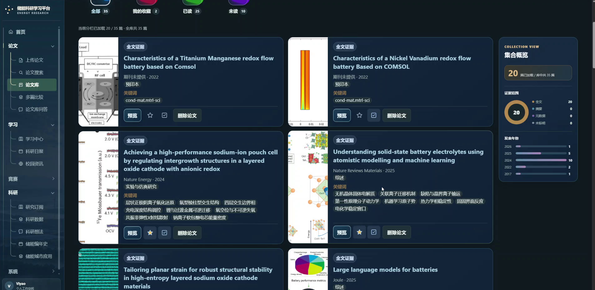 |

### 02 · 对照原文，读懂论文

- **快速理解**：梳理研究问题、方法、核心结果和局限。
- **通俗理解与审稿人速解**：从入门解释与研究评价两个角度阅读。
- **术语、图表与证据核验**：结合原文页码查看概念、实验条件与图表说明。
- PDF 原文与研读报告并排展示，支持笔记及按需 OCR、版面分析和视觉增强。

| 原文与研读报告 | 专业术语解释 |
| :---: | :---: |
| 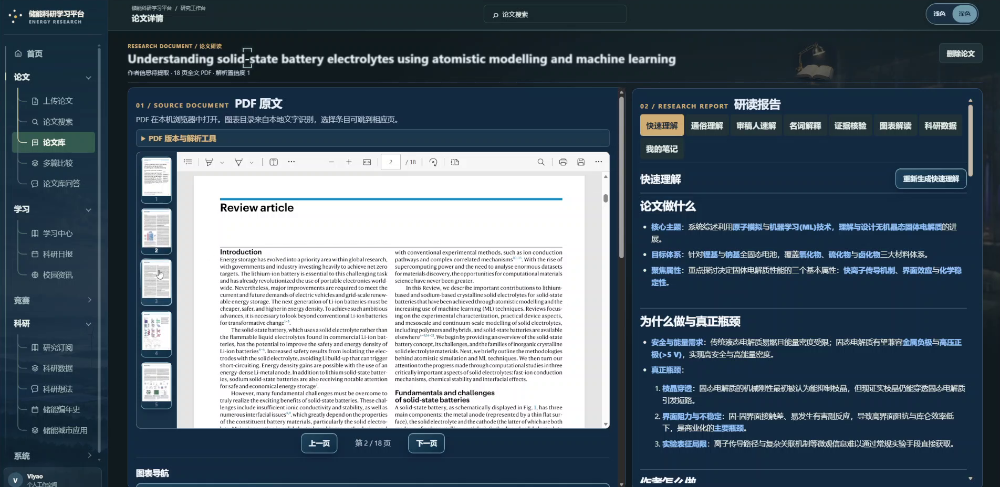 | 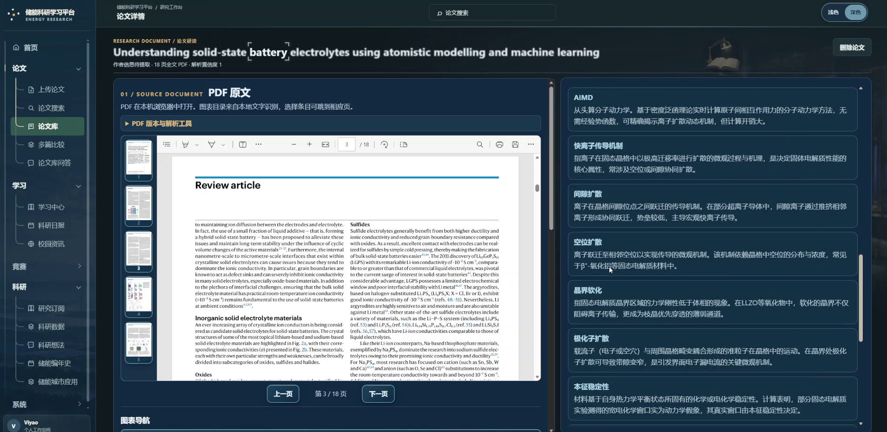 |

### 03 · 循证问答与多篇比较

- 向个人论文库提问，查看检索到的原文证据与页码。
- 选择 **2–6 篇论文**，围绕研究问题、材料、方法、结果和局限进行比较。
- 区分原文依据与 AI 归纳，保留继续追问、预览证据及返回原文的入口。

| 论文库问答与引用 | 多篇论文比较 |
| :---: | :---: |
| 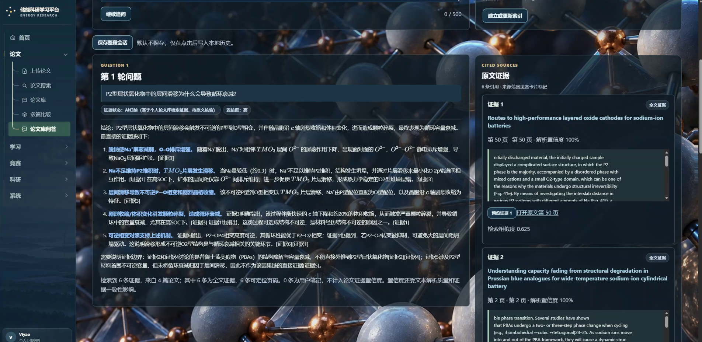 | 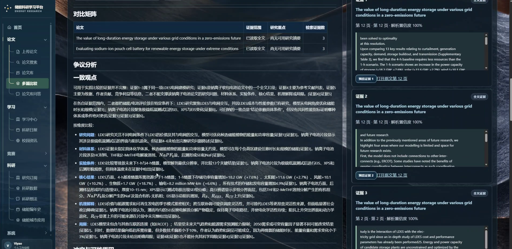 |

### 04 · 把阅读变成可以复习的知识

- 从已读论文创建学习包，生成、编辑和排列知识卡片。
- 通过四类自测检查理解，查看解析与薄弱概念。
- 手动记录掌握程度，制定学习计划并安排间隔复习。
- 保留来源快照，支持学习包版本管理与导出。

| 学习中心 | 知识卡片 |
| :---: | :---: |
| 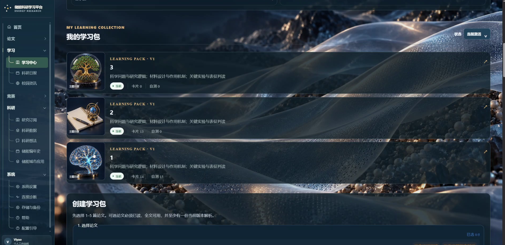 | 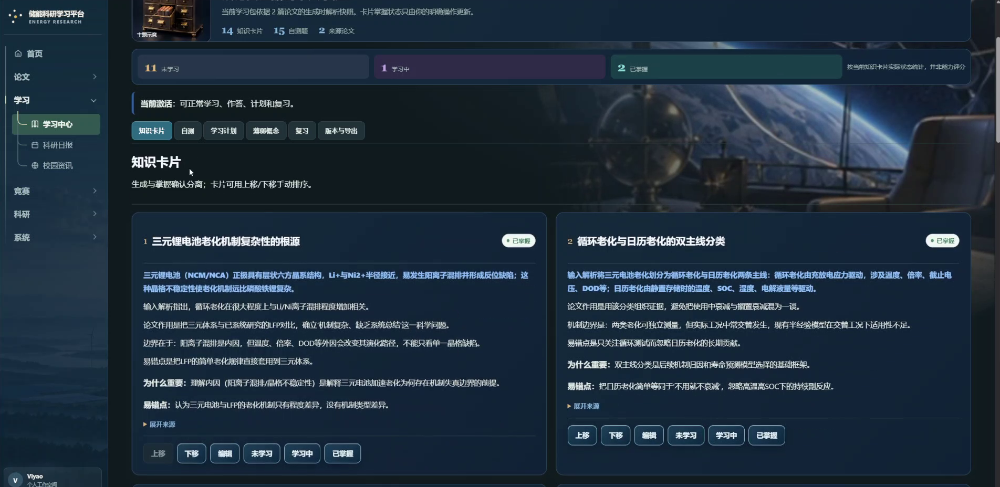 |

### 05 · 从数据走向科研想法与实验设计

- 导入 **CSV / XLSX**，确认工作表、列、单位、缺失值和数据来源。
- 运行固定统计与科研分析配方，查看条件、结果和分析记录。
- 选择论文或数据证据，整理研究问题、假设、证伪条件与可行性。
- 编辑九项实验设计，结合审查提示修改，导出 **Markdown、Word、PPT**；数值分析可导出复现 ZIP。

| 科研数据 | 科研想法 |
| :---: | :---: |
| 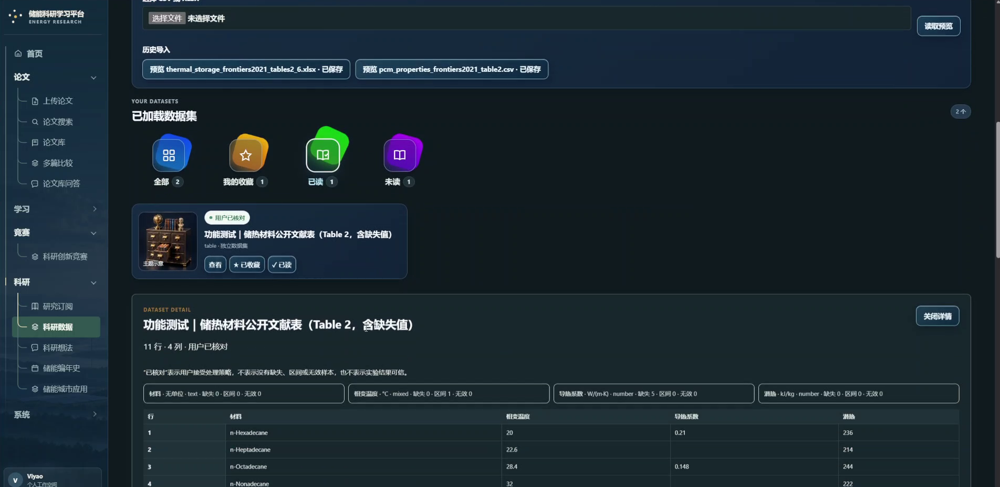 | 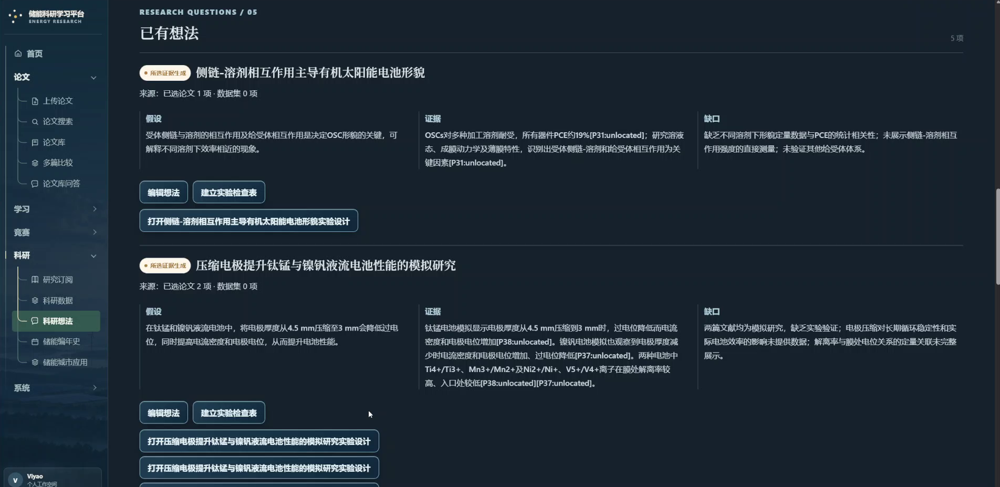 |

### 06 · 建立储能技术与应用的全景认识

- **储能编年史**：覆盖 25 条技术路线，沿历史、材料、论文、企业、政策市场与储能适配六个栏目阅读。
- **储能城市应用**：在八类典型城市能源场景中查看储能角色，切换三种工况理解供需关系。
- 教学图示配合来源说明，帮助连接材料机理、技术演进与能源系统应用。

| 储能编年史 | 储能城市应用 |
| :---: | :---: |
|  |  |

### 07 · 持续追踪研究主题与科研前沿

- 创建研究主题订阅，设置检查周期，查看相关论文与推荐。
- 在科研日报中浏览能源与 AI 前沿资讯，沿来源链接继续阅读。
- 保存主题与检查记录，形成持续关注的研究线索。

| 研究订阅 | 科研日报 |
| :---: | :---: |
| 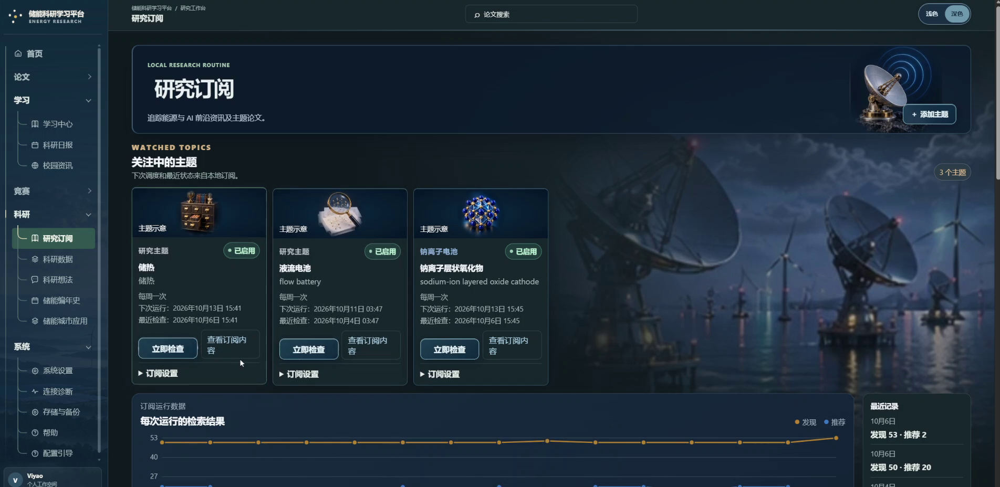 | 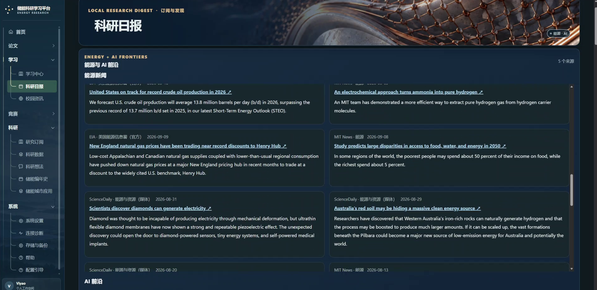 |

### 08 · 发现校园机会，准备科研创新竞赛

- 整理 **西安交通大学公开校园资讯**，按类别查看学术、科研、升学与竞赛信息。
- 查看资讯来源与公开链接，关注相关机会。
- 在科研创新竞赛工作区整理项目论证、规则来源、时间表、评分检查与答辩准备。

| 校园资讯 | 科研创新竞赛 |
| :---: | :---: |
| 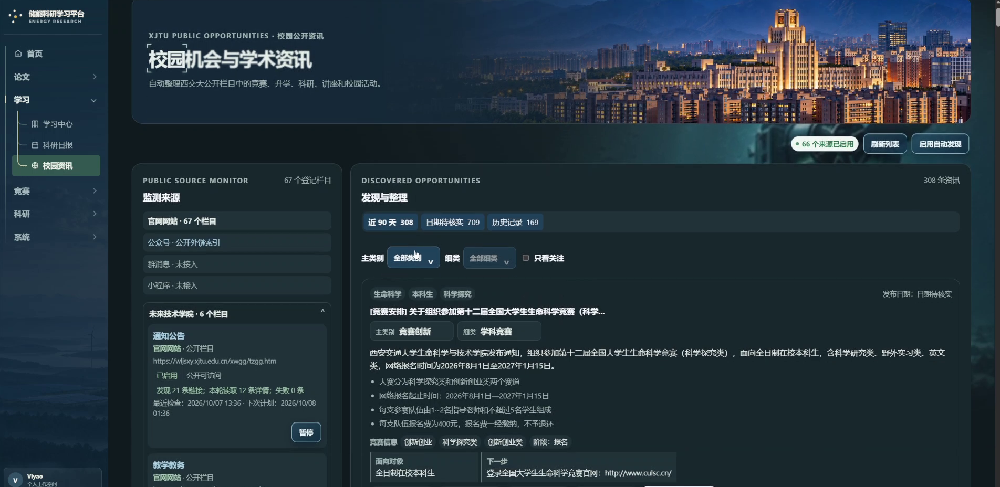 | 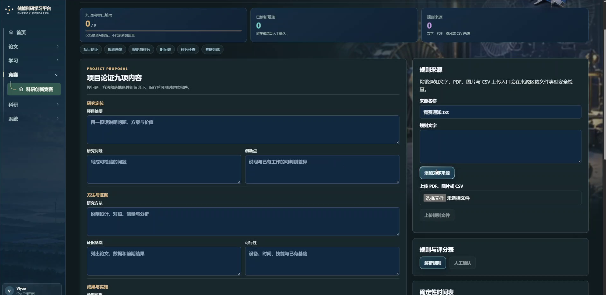 |

<details>
<summary><strong>更多界面：深色首页与 PDF 导入</strong></summary>

| 深色首页 | PDF 导入 |
| :---: | :---: |
|  |  |

</details>

截图展示实际演示界面；页面中的文献、分析与学习记录用于说明操作流程。详细步骤见[从论文到学习与研究](docs/github/WORKFLOWS.md)。

## 快速开始

### Windows 便携版

[**下载 Windows x64 ZIP · 约 884 MiB**](https://github.com/Viyao691/XJTU-energy-learning-platform/releases/download/v0.1.0-windows-portable/Energy-Research-Copilot-Windows-x64.zip)

1. 下载 Release 中的便携版 ZIP，解压到可写目录。
2. 双击 **`启动储能科研平台.cmd`**。
3. 按启动器提示在浏览器中打开平台；使用期间保持控制台开启。

运行包已集成 Python、Node 和所需运行依赖，无需另装 Docker。默认 **Mock 演示模式**不需要 API 密钥。真实模型服务与 OCR 权重按需配置。GitHub 自动生成的 “Source code” ZIP/TAR 是源码归档。

[便携版使用说明](docs/github/PORTABLE.md) · [所有 Releases](https://github.com/Viyao691/XJTU-energy-learning-platform/releases)

### 从源码启动

先安装 Docker Desktop，或 Docker Engine 与 Docker Compose。

```bash
git clone https://github.com/Viyao691/XJTU-energy-learning-platform.git
cd XJTU-energy-learning-platform
```

**Windows · PowerShell**

```powershell
Copy-Item .env.example .env
powershell.exe -NoProfile -ExecutionPolicy Bypass -File .\start.ps1 -Rebuild
```

**Linux**

```bash
cp .env.example .env
docker compose up -d --build
```

Windows 启动器会选择空闲端口并打印实际地址；Linux 默认打开 `http://localhost:3000`。首次构建会下载依赖，需要一定时间与磁盘空间。

[安装、配置与开发说明](docs/github/SETUP.md)

## 模型与运行方式

- **模型选择**：系统设置提供 18 项供应商选项，也可配置兼容接口或本地 Ollama。
- **语义检索**：个人论文库可使用本地 Ollama `bge-m3`；Mock 基础演示不依赖它。
- **文档处理**：按需启用 OCR、可选 Docling 解析或页面视觉增强。
- **本地资料**：论文、文件和数据库保存在本机；API 密钥仅由后端保存。云端模型按所选功能接收相应输入。
- **使用边界**：当前在本机启动并通过浏览器操作；模型归纳与科研候选需要对照来源人工复核。校园与文献来源的可用性以实际访问结果为准。

## 技术结构

| 层次 | 技术与职责 |
| --- | --- |
| 界面 | Next.js 15 · React · TypeScript；论文阅读、学习与科研工作区 |
| 服务 | FastAPI · Python 3.12；文献、学习、科研与模型服务 |
| 数据 | SQLite · Alembic · 本地文件存储 |
| 运行 | Docker Compose；Windows x64 便携启动器 |

## 文档与许可

- [便携版使用说明](docs/github/PORTABLE.md) · [源码安装与配置](docs/github/SETUP.md)
- [论文到学习与研究的操作流程](docs/github/WORKFLOWS.md)
- [架构](ARCHITECTURE.md) · [API 设计](API_DESIGN.md) · [隐私说明](PRIVACY.md)
- [素材来源与许可](docs/github/ASSETS.md) · [MIT License](LICENSE)

MIT 适用于项目代码；摄影、字体、图标及其他第三方素材遵循各自许可，来源与署名记录随项目保留。
# 公网轻量网站部署

公网版本使用独立`compose.web.yml`和`Dockerfile.web`，邮箱登录后使用个人科研数据；桌面启动命令不变。服务器安装、私密环境、明确数据库迁移、DNS/Caddy及回退步骤见[deploy/web/README.md](deploy/web/README.md)，当前上线边界见[CURRENT_STATUS.md](CURRENT_STATUS.md)。首次网站部署使用空库，不上传本机私人论文或沿用本机会话。

